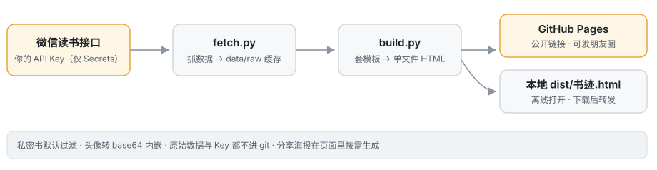
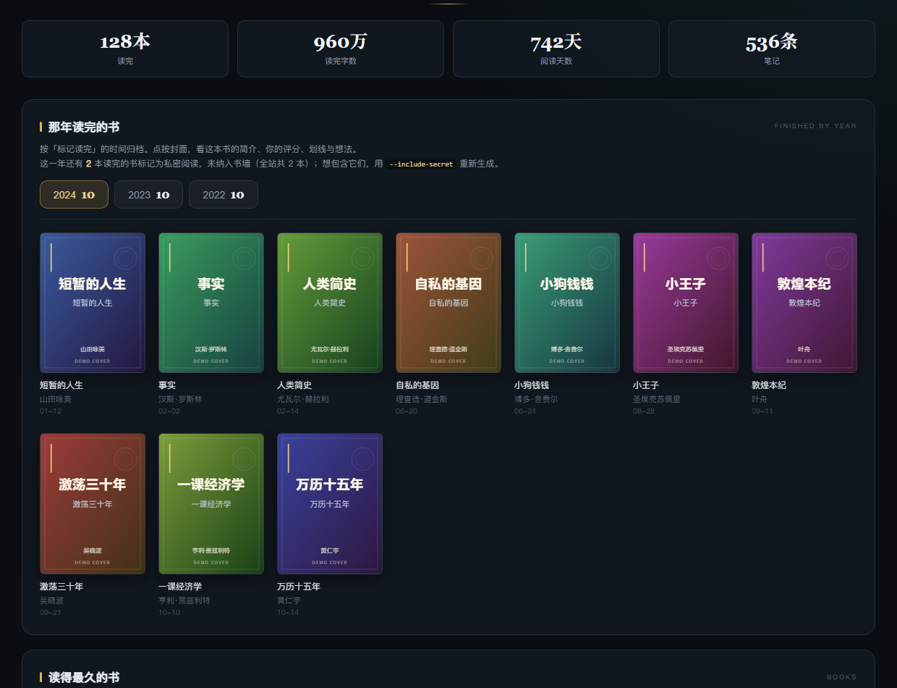
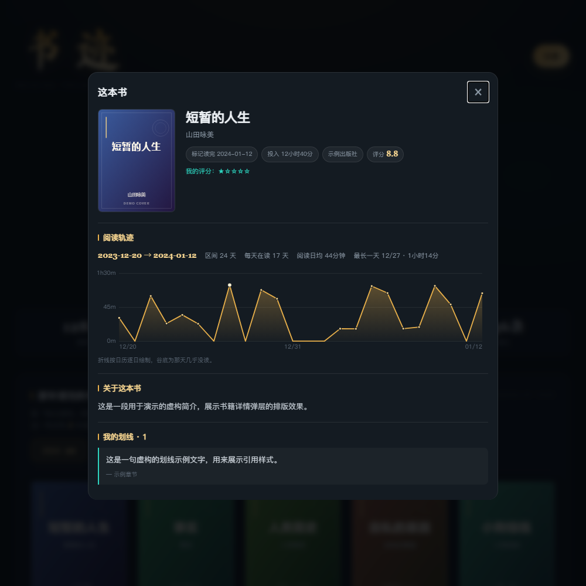
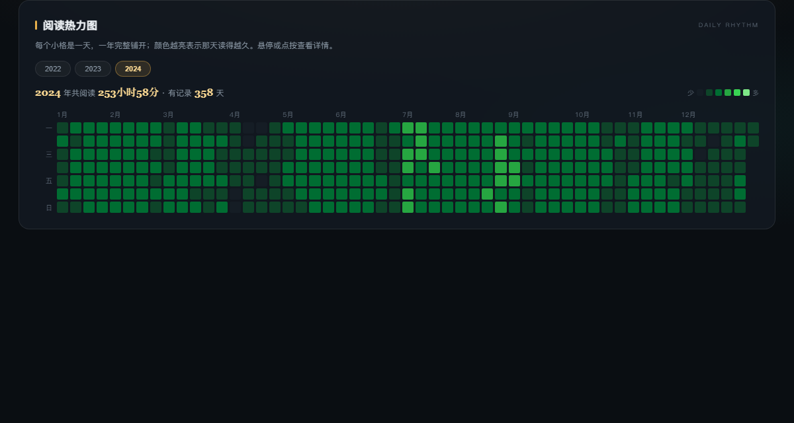
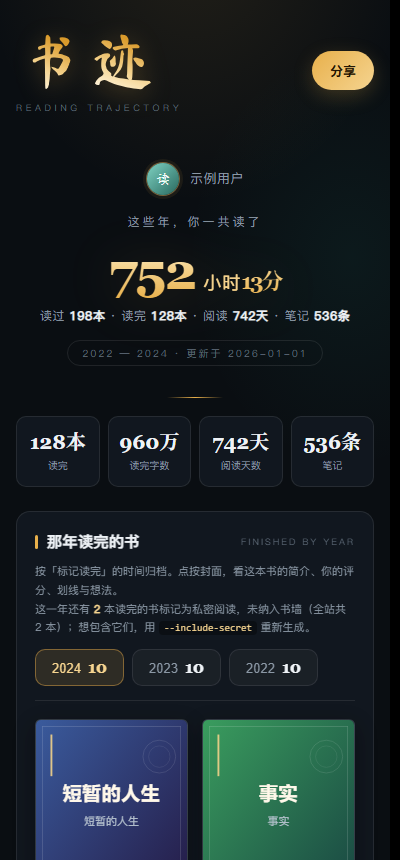

# 书迹 · Shuji

用你自己的微信读书数据，一键生成一张属于你的阅读轨迹页。Fork 仓库、填一个 Key、点一下按钮，就得到一个**能直接发朋友圈的链接**。

[查看演示页 →](docs/demo.html) · [效果预览图](docs/demo-preview.png) · [图解说明](#效果图解)

页面以**电脑版宽屏**为主，手机也能看：Hero 总时长 + 按年份切换的封面书墙（点封面看单本阅读轨迹、简介/评分/划线/想法）+ 书名时长词云 + 逐日热力图 + 阅读画像（时段、作者、年度时长、勋章）+ **模块可选的分享海报**。单文件 HTML，数据内嵌，下载后离线可看。

## 效果图解

以下截图全部来自 [演示页](docs/demo.html)：**书名、作者、头像、统计数字都是虚构的**，不对应任何真实账号，可以放心公开引用。示例书的封面是带书名/作者的 SVG 示意图（底部标有 `DEMO COVER`），不是真实书籍封面，也不是抓取失败。



**① 首屏**：头像 + 昵称、`这些年一共读了`、四项指标（读完 / 读完字数 / 阅读天数 / 笔记）。词云与热力图在下方，宽屏优先，手机上改成单列。


**② 按年书墙**：右上角年份页签切换，每张封面可点开。封面下方是书名、作者、标记读完的日期，提示行说明当年被过滤掉的私密书本数。



**③ 单本详情**：点封面后弹出这本书的**阅读轨迹折线图**（横轴日历天、纵轴当天时长），下面接书籍简介、你的评分、划线与想法。所有内容来自你自己的账号。



**④ 逐日热力图**：GitHub 风格矩阵，一个格子就是一天，一年完整铺开不横向滚动；月份标签对齐实际列，颜色越亮表示那天读得越久。



**⑤ 阅读画像**：24 小时分布（峰值小时高亮）、文字/听书占比、分类光谱、常读作者、逐年时长、勋章墙。数据均来自官方聚合统计。


**⑥ 分享海报**：640px 宽竖图，左侧预览右侧勾选模块，改动即时重排；可下载 PNG、复制文案，也可调用系统分享。海报里的头像是内嵌的，离线也能导出。


**⑦ 手机端**：390px 宽度下保持单栏，头像、大数字和指标条完整可见，书墙两列铺开。



## 发布前自查

- [ ] 本地跑通 `python generate.py`，打开 `dist/书迹.html` 确认数字、封面、海报都正常
- [ ] 用 `python tools/make_demo.py` 生成演示页并检查（全虚构数据，可随仓库公开）
- [ ] 确认 `git status` 里没有 `data/raw/`、`dist/`、`config.json`、`.env`、真实截图
- [ ] GitHub 仓库已创建，`WEREAD_API_KEY` 只放在 Actions Secrets 里
- [ ] `Settings → Pages → Source` 已选 **GitHub Actions**

## 它做了什么

- **「书迹」行楷艺术字**：从开源字体提取矢量轮廓内嵌页面，任何设备离线都一致（字体授权见文末）
- **头像 + 昵称**：取自 `/user` 接口，头像转成 base64 内嵌（约 4KB），不依赖第三方图床，离线与导出海报都能用
- **Hero 大数字**：把这些年读过的总时长作为视觉主角
- **按年书墙**：按 `finishedDate` 把读完的书归档到年份，显示封面、书名、作者、读完日期；点封面弹出详情——**这本书的逐日阅读轨迹折线图**、书籍简介、你的评分、你的划线与想法（全部来自你自己的账号，不展示他人点评）
- **单本阅读轨迹**：详情里的折线图画的是「这本书从哪天读到哪天、每天读多久」，横轴是日历天、纵轴是当天时长；同时给出区间天数、有阅读天数、阅读日均与最长的一天
- **书名词云**：SVG 螺旋布局，字号按全历史阅读时长缩放；悬停看全名与时长
- **阅读热力图**：经典 GitHub 风格矩阵，**一格 = 一天**，铺满整行宽度不横向滚动；月份标签对齐实际列，按当天阅读时长着色，点按看当天详情
- **阅读画像**：24 小时时段分布（找出你的「黄金阅读钟点」）、文字阅读 vs 听书占比、最常读的作者、逐年总时长对比、勋章墙；读完总字数直接进 Hero 上方指标条
- **朋友圈分享**：640px 宽竖版海报，8 个模块逐个可勾选——总时长、读完与字数、一天里的你（24 小时柱状）、文字/听书、分类偏好、读得最久的书、逐年时长、署名；勾一下就重排，海报高度跟着变。电脑端是「海报 + 选项」双栏，手机端单栏。可下载 PNG、复制文案、调用系统分享，也可直接复制页面链接

## 5 分钟上手

### 1. 拿到你的 API Key

去微信读书 Skill 官网 <https://weread.qq.com/r/weread-skills>，微信扫码登录后点「获取 API Key」，复制形如 `wrk-xxxxxxxx` 的字符串。

**Key 绑定你自己的账号，数据只有你自己能看到。** 不要把它发给别人或提交到仓库。

### 2. Fork 这个仓库

点右上角 `Fork`，得到你自己的副本（例如 `github.com/你的用户名/shuji`）。

### 3. 把 Key 存进 Secrets

在**你的**仓库里：`Settings` → `Secrets and variables` → `Actions` → `New repository secret`

- Name 填 `WEREAD_API_KEY`
- Secret 粘贴你刚才复制的 Key

### 4. 开启 Pages

在你的仓库里：`Settings` → `Pages` → Build and deployment 的 Source 选 **GitHub Actions**。

### 5. 运行

`Actions` 标签 → 左侧选 `生成我的书迹` → 右侧 `Run workflow` → 再点一次绿色按钮。

约 1～2 分钟后刷新页面，顶部会出现部署链接：`https://你的用户名.github.io/shuji/`。这个链接就能发朋友圈。

之后每周一 08:00（北京时间）会自动刷新一次；想立刻更新就再点一次 `Run workflow`。

## 隐私说明（重要）

- **Key 只从 Secrets 注入环境变量**，只放进请求 header；不进代码、不进日志、不进生成的 HTML、不进 git 历史。
- **页面链接是公开的**。任何拿到链接的人都能看到页面上的阅读数据。分享前请确认你愿意公开这些内容。
- 默认**排除私密书**：书墙、词云与个人笔记均已过滤标记为私密的书。但总览数字、总时长与热力图来自官方聚合统计，**仍包含全部阅读（含私密书）**，无法按私密标记拆分。
- **书墙本数比官方「读完」少，通常就是这个原因**：标为私密阅读的书不会出现在书墙里。书墙标题下方会直接写明「这一年还有 N 本读完的书标记为私密」，不会让你对着数字猜。
- 如要把私密书也算进书墙和词云，运行 workflow 时勾选 `include secret`（本地用 `python fetch.py --include-secret`），不推荐用于公开分享的页面。
- 生成的 HTML 与抓取缓存都**不提交到仓库**：`.gitignore` 已排除 `dist/`、`data/raw/`、`preview-*.png`。GitHub Pages 上发布的是 Actions 现场生成的产物，你的原始数据不会进 git。
- **头像会一起进 HTML**：抓取时把微信读书头像下载成 base64 内嵌，页面不再请求 `thirdwx.qlogo.cn`。但头像本身是你的微信头像，页面一旦公开，它也会被看到。
- 分享海报默认**不含逐日热力图**（一天一格太密，缩到竖图里看不清）；逐年时长是年度聚合，不是逐日轨迹。总量类数据仍含私密书贡献。

## 数据口径

- 只展示有阅读记录的年份；没有数据的年份不出现。
- **缓存策略**：历史年份与旧书走本地缓存；**当前年份、最近 3 天在读的书（逐书时长）、最近一个月读过的书（简介/划线/想法）**每次运行都会重新拉取。否则今年的统计和热力图会停在第一次运行的那天——曾因此出现过「今年读完 3 本，页面只显示 1 本」。
- 年度总时长来自官方 `totalReadTime`；逐日明细只用于校验与热力图，不跨年加总。
- 词云是**全历史累计**阅读时长，与按年统计不同。
- 读完本数按官方年度统计展示；书架标记数与之可能不同。
- **书墙按每本书的 `finishedDate`（读完时间）归档**，与官方年度统计的口径不完全一致，因此书墙本数可能与顶部「读完」数字有出入。
- 书籍简介来自 `/book/info`；划线来自 `/book/bookmarklist`；想法来自 `/review/list/mine`（都是你自己的笔记），不拉取他人点评或热门划线。
- **单本逐日轨迹来自 `/book/readinfo` 的 `readDetail`**：`beginReadingDate` / `lastReadingDate` 给出这本书的起止日期，`data` 给出有阅读的那些天各自的秒数。这个明细由微信读书服务端决定返回范围，部分书只返回最近一段阅读区间（实测最多约 28 天），所以「累计阅读天数」可能大于折线图里的点数，页面上会注明。
- 阅读画像里的 24 小时分布来自 `preferTime`：接口按 **6 点 → 次日 5 点** 排列，页面已旋回 0–23 点；「13 点」这类标注是数据里的峰值小时，不是固定文案。
- 年度时长对比与热力图同源（年度 `totalReadTime`），避免同一页出现两个对不上的数字。
- 读完总字数来自 `shareInfo.finishReadingWordCount`（全历史累计），与单本 `wordCount` 无关（`/book/info` 的 `wordCount` 当前恒为空）。
- 书籍评分是百分制再除以 100（如 `846` → `8.5`），并带官方评级文案（神作 / 脍炙人口 / 值得一读）。

## 配置项（进阶）

复制 `config.example.json` 为 `config.json` 后修改：

| 字段 | 默认 | 说明 |
|---|---|---|
| `maxBookCloud` | `100` | 书名词云候选词条数（页面实际显示前 56 条） |
| `maxFinishedPerYear` | `200` | 书墙每年最多展示多少本，控制单文件体积 |
| `output` | `dist/书迹.html` | 本地生成的输出路径 |

私密书开关走 workflow 的 `include_secret` 输入（本地运行用 `--include-secret` 参数），不在配置文件里。

## 本地运行（可选）

不想用 GitHub 的话也能本地生成：

```bash
# 1. 装 Python 3.9+（零 pip 依赖，只用标准库）
# 2. 设置 Key
export WEREAD_API_KEY=wrk-xxxxxxxx          # macOS / Linux
$env:WEREAD_API_KEY='wrk-xxxxxxxx'          # Windows PowerShell

# 3. 生成
python generate.py

# 可选：--include-secret 包含私密书；--rebuild 清空缓存重新抓取
```

打开 `dist/书迹.html` 即可。本地生成的数据只在你电脑上。

## 目录结构

```
.github/workflows/generate.yml  Actions：拉数据、生成页面、部署 Pages
weread.py           网关客户端（header 传 Key / 超时 / gzip / 重试）
fetch.py            抓取层：逐年探测、逐书时长、按读完年份归档、简介/划线/想法补抓、隐私过滤
build.py            渲染层：字段白名单 + 模板 → 单文件 HTML
generate.py         一键入口
templates/index.html 页面模板（封面书墙 + 单本逐日折线 + SVG 词云 + 逐日热力图 + 阅读画像 + 模块化海报 + 内嵌矢量艺术字，零前端依赖）
tools/swap_font.py  换艺术字字体的工具
tools/make_demo.py  用虚构数据生成演示页
docs/demo.html      演示页（全虚构数据）
docs/guide-*.png    演示页图解截图（全虚构数据，可公开）
docs/guide-flow.svg 生成与发布流程图
data/raw/           抓取缓存（不提交）
dist/               生成物（不提交）
```

## 字体授权

页头与海报的「书迹」艺术字轮廓来自 **[Ma Shan Zheng](https://fonts.google.com/specimen/Ma+Shan+Zheng)**（马善政毛笔楷书），依据 **SIL Open Font License 1.1** 授权，允许嵌入与再分发。字体版权归原作者所有，完整授权文本见仓库根目录 `FONT_LICENSE.txt`。

演示页也使用相同字体轮廓。要换成其他 OFL 字体：

```bash
# 下载字体后预览字形 bbox，确认无误再 --apply
python tools/swap_font.py path/to/font.ttf
python tools/swap_font.py path/to/font.ttf --apply
python build.py
```

## 免责声明

本项目是个人工具，依赖微信读书官方 Skill 的非公开网关接口。接口可能变更或限流，项目不保证长期可用。请遵守微信读书的相关服务条款，仅用于个人查看自己的数据，勿用于批量抓取或商业用途。项目与腾讯、微信读书官方无隶属关系。

## License

MIT © 2026
